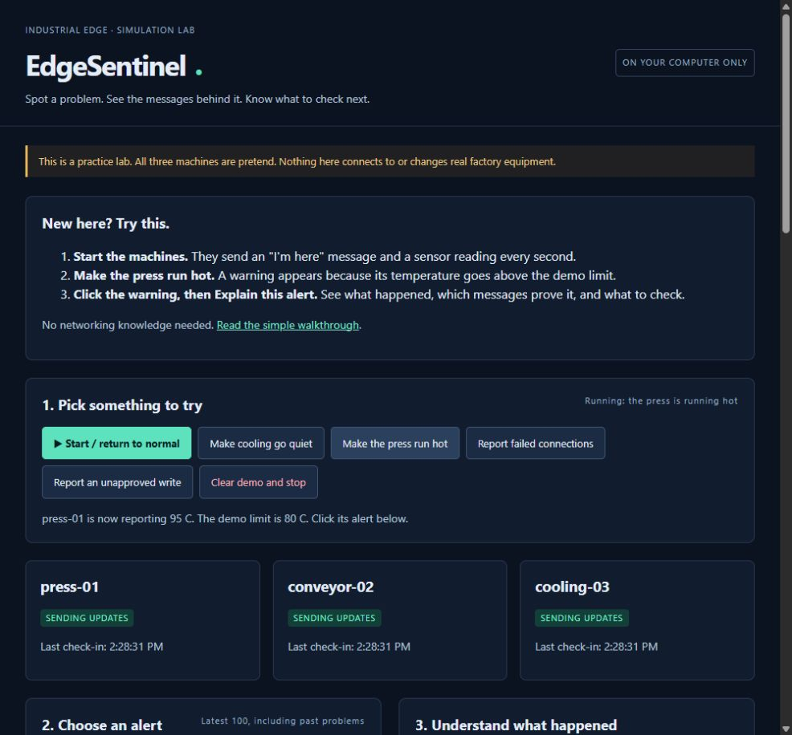
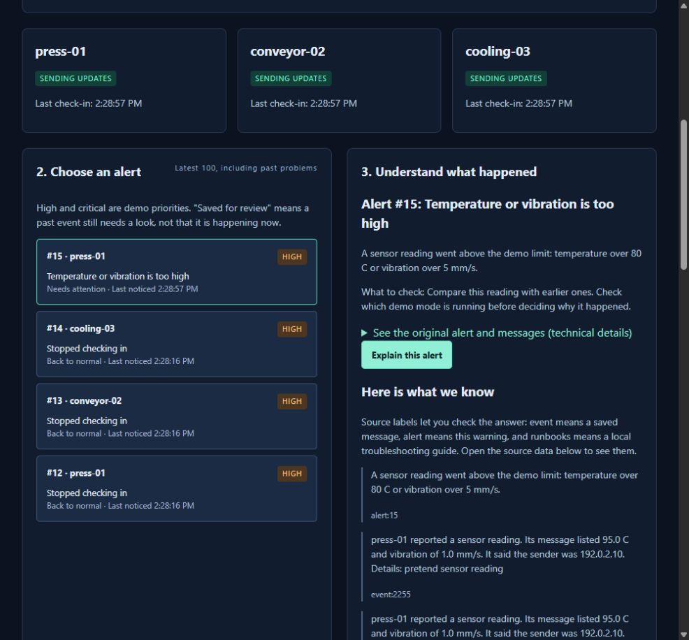

# EdgeSentinel

**Three pretend machines. Four problems you can trigger. An explanation you can check.**

EdgeSentinel is a small factory-network practice lab that runs on your own computer.
Click a button to make a machine run hot, stop checking in, report failed connections,
or report a request that breaks the rules. The app spots the problem, saves the
messages behind it, and explains what to look at next.

You do not need factory equipment, an account, an API key, or a paid service.
The machines are simulated. The local TCP connection, message checks, SQLite
storage, alerts, and browser app are real working code.



## Why I built it

I built this as a hands-on project for an Industrial IoT software engineering
interview. I wanted to show the whole path from a device message to a useful answer,
with enough detail to explain my choices and test them.

The question was simple: **can I show what went wrong and point to the messages
that support the answer, without pretending I know more than I do?**

Read [what I built, why I chose it, and how it works](docs/project-story.md).

## Get it running

You need **Python 3.11 or newer** and an internet connection for the first install.
After that, the demo runs locally without internet. It was tested on Windows with
Python 3.13.5. The macOS and Linux commands are included, but were not run here.

Get the code with Git:

```sh
git clone https://github.com/marpusakethram/EdgeSentinel.git
cd EdgeSentinel
```

No Git? Click **Code > Download ZIP** on this repository, unzip it, and open a
terminal in the unzipped folder. You should see `README.md` and `requirements.txt`.

### Windows PowerShell

```powershell
python -m venv .venv
.\.venv\Scripts\python.exe -m pip install -r requirements.txt
.\.venv\Scripts\python.exe -m edge_sentinel
```

### macOS or Linux

```sh
python3 -m venv .venv
.venv/bin/python -m pip install -r requirements.txt
.venv/bin/python -m edge_sentinel
```

Open **[http://127.0.0.1:8000](http://127.0.0.1:8000)** in your browser.
Keep that terminal open while you use the app. Press **Ctrl+C** in it to stop.
`127.0.0.1` means your own computer. Everyone who downloads this runs their own copy.

The virtual environment (`.venv`) keeps this project's Python packages separate
from other projects. You do not need to activate it because the commands above
use its Python directly.

## Try this first

1. Click **Start / return to normal**. The three machine cards say **Sending updates**.
2. Click **Make the press run hot**. Its pretend temperature jumps from 45 C to 95 C.
3. Click the new alert. The demo limit is 80 C, so the app explains why it flagged it.
4. Click **Explain this alert**. You get a short explanation, source labels, and checks to try.
5. Open **See all source data and guides**. A label like `event:12` means saved message number 12.
6. Click **Start / return to normal** again. The hot-machine alert changes to **Back to normal**.

The app has its own [simple walkthrough](static/guide.html), with the same steps
and a short glossary. Open it through the link at the top of the running app.



### Try the other problems

| Button | What happens | What you should see |
| --- | --- | --- |
| Make cooling go quiet | `cooling-03` stops checking in | An alert after 6 to 7 seconds |
| Make the press run hot | `press-01` reports 95 C | A high-priority alert straight away |
| Report failed connections | `conveyor-02` sends three made-up failure reports | A medium-priority alert straight away |
| Report an unapproved write | A message claims a sender and operation that are not allowed | A critical-priority alert, with no actual machine change |
| Clear demo and stop | Stops the built-in machines and deletes saved demo rows | Empty history, ready for another try |

Only one mode runs at a time. New modes keep old alerts so you can compare them.
Failed-connection and write alerts stay **Saved for review** until you clear the
demo. That label records a past problem; it does not mean it is still happening.

If you leave the machines stopped for over 6 seconds, the app warns that they are
not checking in. That is expected, including just after clearing the demo.

## How it works


1. **The simulator sends messages.** Each pretend machine sends an "I'm here"
   message and a sensor reading every second through a local TCP connection.
2. **The gateway checks them.** It rejects broken JSON, unknown machines, missing
   fields, invalid values, and messages bigger than 4 KB.
3. **SQLite saves them.** Each accepted message gets its own number, so an alert
   can point back to exactly what arrived.
4. **Four rules look for problems.** They check for silence, high readings,
   repeated failure reports, and write requests that break the demo policy.
5. **The helper reads the evidence.** It reads the alert, device status, recent
   messages, and matching local guides. It returns a short answer with sources.
6. **The dashboard shows the result.** You can see the alert, read the answer,
   and open the original data yourself.

The helper is not an LLM. It follows a fixed read-only workflow and builds its answer
from saved facts and guide text. No model, cloud call, or API key is involved. This
keeps the demo repeatable and avoids invented diagnoses. It never fixes anything
or sends a control command.

More detail: [architecture and data flow](docs/architecture.md),
[API and message format](docs/api-and-schema.md), [copy-paste demo commands](docs/demo-commands.md),
[security and limits](docs/security-and-limitations.md).

## What the rules actually check

| Problem | Exact rule |
| --- | --- |
| Quiet device | No heartbeat received for more than 6 seconds, with a fresh grace period at startup/reset |
| High reading | Temperature above 80 C **or** vibration above 5 mm/s |
| Repeated failures | At least 3 failure reports from one device within 10 seconds, including the boundary |
| Unapproved write | Reported sender is not `192.0.2.10` **or** request is not exactly `set_speed=50` |

These are hand-written rules, not machine learning. Sender addresses are just
claims inside fake messages. Timing uses when the gateway received a message,
not whatever time the sender wrote down.

## Find your way around the code

| File | What it does |
| --- | --- |
| `edge_sentinel/simulator.py` | Plays the three machines and changes their reports |
| `edge_sentinel/schema.py` | Defines a valid message and rejects bad input |
| `edge_sentinel/gateway.py` | Receives TCP messages and checks for missing heartbeats |
| `edge_sentinel/store.py` | Saves messages and alerts in SQLite |
| `edge_sentinel/detector.py` | Applies the four rules |
| `edge_sentinel/assistant.py` | Reads evidence, finds guides, and builds a cited answer |
| `edge_sentinel/app.py` | Serves the API and browser app |
| `static/` | The dashboard, styles, and beginner walkthrough |
| `runbooks/` | Short troubleshooting guides |
| `tests/` | Automated checks and a full local demo check |

The [interview guide](docs/interview-guide.md) walks through each module and gives
five likely questions with honest answers.

## Check that it works

From the project folder on Windows:

```powershell
.\.venv\Scripts\python.exe -m unittest discover -s tests -v
.\.venv\Scripts\python.exe tests\smoke.py
.\.venv\Scripts\python.exe -m pip check
```

On macOS/Linux, use `.venv/bin/python` in place of `.\.venv\Scripts\python.exe`.
The smoke check starts a temporary server, tries all four problems, waits for the
quiet-device alert, checks recovery and reset, then stops its server. It also saves
an example answer in `docs/sample-investigation.json`.

See [what was actually verified](docs/verification.md) and the
[real sample answer](docs/sample-investigation.json). No real industrial equipment
or performance benchmark is claimed.

## Common questions

**Why does it say a machine is missing before I start?**
The app is listening, but no machine has checked in. Click Start. After 6 seconds
of silence it raises a warning, just as the rule says it should.

**Why are old alerts still there?**
They are history. Normal readings clear hot-machine and quiet-machine alerts.
Failure and write alerts stay saved for review until you clear the demo.

**What if port 8000 is busy?**
Stop the other copy, or run this instead:

```powershell
.\.venv\Scripts\python.exe -m uvicorn edge_sentinel.app:app --host 127.0.0.1 --port 8001
```

Then open `http://127.0.0.1:8001`. If the TCP port 8765 is busy too, set
`$env:EDGESENTINEL_TCP_PORT='8766'` in PowerShell before starting. On macOS/Linux,
use `export EDGESENTINEL_TCP_PORT=8766`.

**Where is my data?**
In `data/edgesentinel.db` on your computer. It is excluded from Git. An optional
`EDGESENTINEL_DB` environment variable can choose another writable file.
`.env.example` explains the settings; the app does not automatically load `.env`.

**Can someone else use this?**
Yes. Download the public repository and follow the setup steps. No access request
is needed. This is a local app, not a hosted public service. Do not expose its ports
to the internet or a factory network. Run one server worker at a time.

## Honest limits and what I would improve next

This is a learning project. It does not talk to PLCs, implement industrial protocols,
authenticate devices, or diagnose physical faults. Local programs can forge messages.
There is no automatic data cleanup, so long sessions keep growing the database.

The next three improvements I would make:

1. Restore detector state after a restart, handle replayed messages, and use a
   clock that cannot jump when the system time changes.
2. Add storage limits, a bounded message queue, and measured overload/failure tests.
3. Build an evaluation set for the helper before trying an optional small model.
   Keep citations, read-only tools, and the current fallback.

Built by [Saketh](https://github.com/marpusakethram) as an Industrial IoT interview project.
