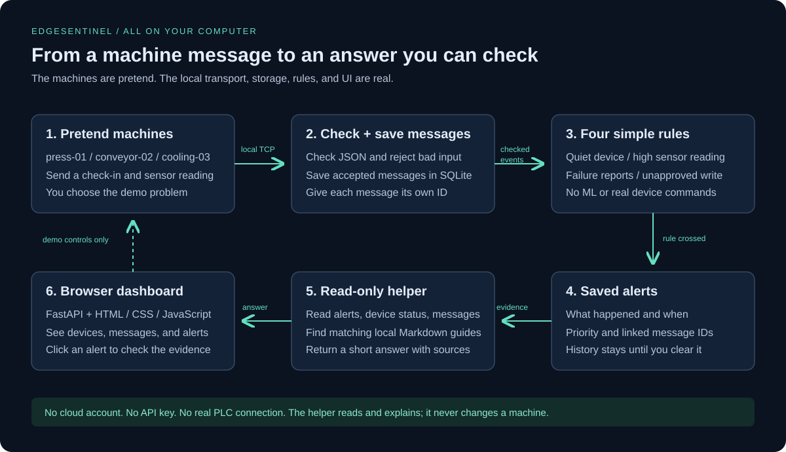
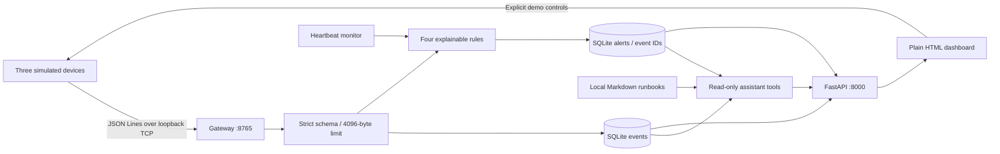

# Architecture

Think of the app as a small mailroom. The pretend machines send notes. The gateway
checks each note and files it away. The rules flag anything worth a look. The
helper opens the relevant notes and a troubleshooting guide, then explains what
we know. The browser lets you see every part of that story.

The diagram below is the same flow with the technical names. TCP is the local
message connection. SQLite is the file that holds the data. FastAPI serves the
browser page and the API. A runbook is just a short Markdown troubleshooting guide.

## Ownership and ordering

### Why one process?

It keeps setup small. One Python process starts the receiver, the simulator, the
timer, and the website. You do not need to launch a database service or coordinate
several apps. The cost is that slow work in that process can hold up the rest.

One Uvicorn worker owns the asyncio TCP server, simulator task, offline-monitor
task, and SQLite connection. API handlers are async so they run on that same event
loop. Short synchronous database operations block that loop; this is an explicit
small-demo compromise, not a high-throughput architecture. No measurements of
production throughput or latency are claimed.

For each line: bound framing → validate JSON/schema → commit event → evaluate rule
→ commit alert if needed → acknowledge event ID. A crash between the two commits
can leave an event without an alert. Delivery retries are not durable or deduplicated.
SQLite WAL improves read/write behavior but does not remove these logical limits.

Alert identity is an autoincrement integer. A partial unique index permits one
active alert per device/rule. Repeated observations update its latest timestamp
and union the evidence IDs, retaining the latest 100 links. Recovery marks the
alert inactive; a subsequent incident gets a new ID. First/latest observation
timestamps are Unix seconds from gateway wall time, not sender timestamps.

## Offline and reset semantics

Only heartbeat events establish liveness. No heartbeat in the first 6 seconds is
`waiting`; after that it is `offline`. Telemetry does not substitute for a heartbeat.
Missing-heartbeat alerts link the last heartbeat when available; otherwise the
alert's explanation and observation timestamps record the absence since startup.

Scenario triggers and reset are serialized by an asyncio lock. Reset stops the
built-in simulator, rejects new clients temporarily, cancels existing handlers,
deletes stored demo rows, and restarts detector grace time. Independent clients may
reconnect after reset; stop them for an empty demo. SQLite ID sequences are retained.

## Assistant boundary

The helper can read and explain. It cannot change a device. Clicking a demo button
changes the simulator through a separate API route; asking for an explanation does
not call those routes.

The assistant receives an existing alert ID, collects evidence/status/recent events,
retrieves matching runbooks, and renders a deterministic response. It has no
remediation path and never calls demo-control endpoints. Every narrative observation
references an alert or event, and every retrieved instruction includes its filename.
The complete tool results are inspectable in the API/dashboard. No autonomous
planning, embeddings, trained model, remote service, or MCP server is implemented.
